# Universal Self-Healing Parser

A native Rust library for structural extraction using Tree-sitter and ast-grep.
HTML, JSON, Markdown, and the other built-in `ast-grep-language` languages are
available through `Language`. The library has no HTTP server or browser dependencies.



```sh
cargo test --locked
cargo run --locked --example parse
cargo run --locked --example healing
```

Requires Rust 1.90+. The ast-grep versions are pinned to 0.51.0; `Cargo.lock`
records the tested dependency set. YAML is handled by the maintained
`serde-saphyr` crate, which ast-grep itself also uses.

## Usage

```rust
use universal_self_healing_parser::{Language, ParseRequest, Parser};
# async fn example() -> universal_self_healing_parser::Result<()> {
let parser = Parser::builder()
    .rules_yaml(include_str!("examples/rules.yaml"))
    .build().await?;
let html = "<button>Sign in</button>";
let result = parser.parse(ParseRequest {
    language: Language::Html,
    content: html.as_bytes(),
    rules: Some(&["login-submit"]),
    required: &["login-submit"],
    heal: false,
    snapshot_id: Some("snapshot-1"),
}).await?;
assert_eq!(result.matches[0].text, html);
# Ok(())
# }
```

To load a file, use `.rules_file(path)`. Rules use native ast-grep fields:
`id`, `language`, `message`, `rule`, `constraints`, `utils`, `metadata`, and
other supported properties. Separate multiple YAML documents with `---`.
Global utils from external files are not loaded automatically; declare local
`utils` within the relevant rule.

`rules: None` selects all rules for the specified language. Explicit lists are
validated: unknown IDs, rules for a different language, and required rules
outside the selection cause request errors. `required` only affects how missing
matches are handled. An optional rule with no matches does not trigger healing.

Input is borrowed for the duration of `parse`; results own all their data.
`SourceRange` uses UTF-8 byte offsets `[start, end)` in the original document.
Invalid UTF-8 is rejected without character replacement. Captures include the
name, node kind, text, and range; captures with multiple values are returned as
arrays. ast-grep transformations without a corresponding source AST node are
not assigned fabricated ranges. Internal captures from relational rules may
also be present.

The main document is parsed once. All rules, candidates, and final matching use
the same tree. Tree-sitter error and missing nodes produce `Error::Parse` before
Jev is called. This is a deliberately strict policy for incomplete documents.
Markdown uses the block grammar; this version does not separately parse inline
language injections.

## Healing

1. Identify required rules with no matches.
2. Deterministically build a bounded list of Rule Objects from node kinds,
   exact text, direct children, and descendants; rank them using `message`
   and the previous node kind. Collect local examples and structural context.
3. Send one batch of `choice` questions, each with a `none` option.
4. Validate the selected rules against the same AST and trusted fixtures.
5. Atomically publish validated changes with revision checks.

Accepting a change requires **at least one positive and one negative validation
fixture** per rule. Store them in the rule YAML under `fixtures`:

```yaml
id: login
language: Html
message: Sign in control
rule:
  kind: element
  regex: old-login
fixtures:
  positive:
    - '<div>Sign in</div>'
  negative:
    - '<div>Cancel</div>'
```

Every `positive` document must produce at least one match; every `negative`
document must produce no matches. Both lists need at least one example to
allow healing. Fixtures are optional for ordinary matching and are preserved
during healing, export, and saving. Invalid fixture fields are rejected when
loading rules; fixture documents are parsed when building the parser.
These are trusted examples maintained by the application alongside the rule.
Without this evidence, the rule remains
`unresolved` with `insufficient_evidence`, and no network request is made for it.
See `examples/healing.rs` for a configuration example.

By default, a repaired rule must produce exactly one match in the current
document. To support multiple results, increase `Limits::max_healed_matches`
and provide corresponding validation fixtures. Candidate generation is
intentionally bounded: substantial or semantically complex structural changes
may remain `unresolved`. Fixture validation reduces the risk of an incorrect
replacement but does not prove semantic correctness for all future documents;
the application is responsible for fixture quality.

To use the real API:

```rust,no_run
use universal_self_healing_parser::{HttpJevClient, Parser};
# async fn example() -> Result<(), Box<dyn std::error::Error>> {
let key = std::env::var("JEV_API_KEY")?;
let parser = Parser::builder()
    .rules_file("rules.yaml")
    .jev(HttpJevClient::new(key)?)
    // Include fixtures in rules.yaml for rules that need healing.
    .build().await?;
# Ok(())
# }
```

The client uses the official
[System One API](https://docs.typesafe.ai/api/system-one),
`POST https://api.typesafe.ai/v1/systemone`, a Bearer token, and the `jev-latest`
model. Retries and redirects are disabled. You can supply your own `JevClient`
implementation; local tests use a mock without network access or secrets.
Real requests are covered by separate live tests that must be run explicitly.

Transport errors and Jev timeouts return `Error::Healing` for the initiating parse
and all parses waiting for the same healing attempt, without retries. `none`,
unknown answer options, and failed validation leave the original rules in place;
results retain local matches and report `healing_failed`/`unresolved`. YAML errors,
unsupported languages, invalid input, and exceeded limits return typed errors.
`healing.attempted` indicates an actual client call. A parse operation is never
split into multiple API requests.

## Revisions and persistence

`parser.rules()` returns an immutable `Arc<RuleSet>` with its revision and IDs.
`parser.export_yaml()` exports the current rules; `parser.save_rules(path)`
saves one consistent snapshot using a temporary file and atomic replacement.
The application explicitly requests persistence. YAML comments, ordering, and
original formatting are not preserved; standard fields and values are preserved.
Healing replaces only `rule`, retaining `id`, `language`, `message`, and other fields.

`MemoryRuleStore` supports compare-and-swap. A custom store implements
`RuleStore` and must publish updates atomically. No state lock is held during
the network call. On a revision conflict, parsing returns the original matches
and revision, reports the conflict, and does not retry Jev. Accepted changes are
immediately available to subsequent calls on the same `Parser`. Clones of
`Parser` share the store.

Concurrent healing is coordinated per rule ID and revision within one process,
including separately built parsers using the same `Arc<dyn RuleStore>` allocation.
An overlapping batch waits before starting any healing of its own. After waiting,
each parse reloads the snapshot and matches its own document again, reusing its AST.
Rules covered by the shared attempt are not sent to Jev again by that parse, even
if no repair was selected or the repair does not match its document. Other broken
rules can still be healed in one batch. Waiting does not set `healing.attempted`;
`healing.updated` lists only updates committed by that parse. Cancellation of the
initiating parse also fails its waiters and releases the reservation. Waiting is
bounded by the waiting parser's `jev_timeout`. Different rules can still conflict
on the store's global revision. Independent stores and processes do not share
healing attempts.

File replacement is atomic within the filesystem,
but does not provide CAS between independent processes.

## Limits and boundaries

`Limits` bounds content bytes, AST nodes, matches, candidate size and count,
batch questions and bytes, local execution time, and the wait for Jev. Defaults
are 2 MiB of content, 100,000 nodes, 10,000 matches, 16 candidates per rule,
64 KiB per batch, 5 seconds of local execution, and a 15-second wait for Jev.
HTTP responses are limited to 1 MiB. Batch limits are measured in bytes, not
tokens; API limit errors do not trigger hidden retries.

The local deadline is checked between AST/matcher operations. It does not
interrupt an individual Tree-sitter call or a complex ast-grep match. CPU work
runs in the calling async task; hosts that require strict isolation of untrusted
grammars and rules should use a separate worker or process. Input documents are
not executed, and their URLs are not fetched. Jev receives bounded candidate
examples and structural context; these may still contain sensitive text, so
enabling healing means the host authorizes sending those excerpts. The library
does not log them.

The contract for a future browser adapter is described in `docs/playwright-adapter.md`.

## Tests against the real Jev API

Set `JEV_API_KEY=...` in the project root `.env` file or export `JEV_API_KEY`
in the environment. The environment variable takes precedence. Live tests read
`.env` through `dotenvy`, do not modify the process environment, and do not
print the key. The `.env` file is excluded from Git. Loading `.env` is specific
to tests: the library still accepts the key explicitly through `HttpJevClient::new`.

```sh
cargo test --locked --test jev_live -- --ignored
```

This command makes two paid API requests using synthetic data: it checks a
batch of two `choice` questions and the repair of two rules in one call,
followed by local matching and YAML persistence. Model choices may be
nondeterministic; a failure to heal fails the live test, without hidden retries.

Regular `cargo test --locked` skips both live tests. When run explicitly, a
missing key or malformed `.env` causes the test to fail.
